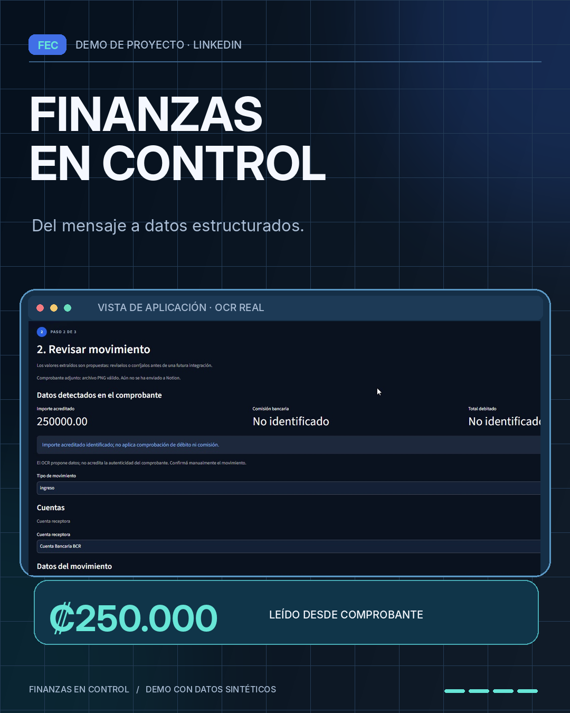
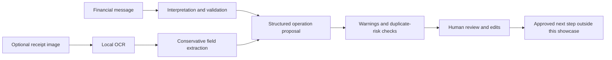
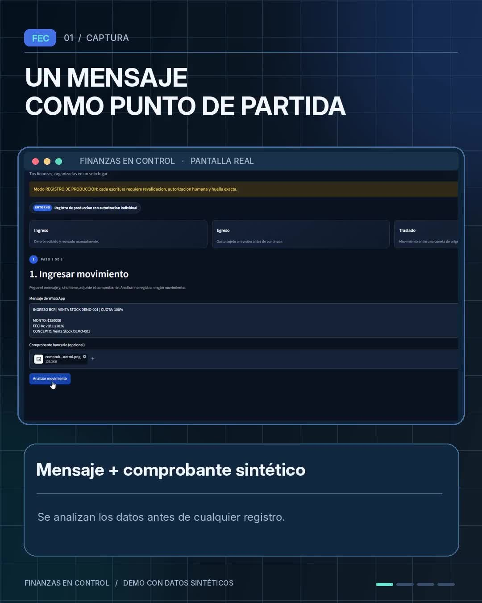
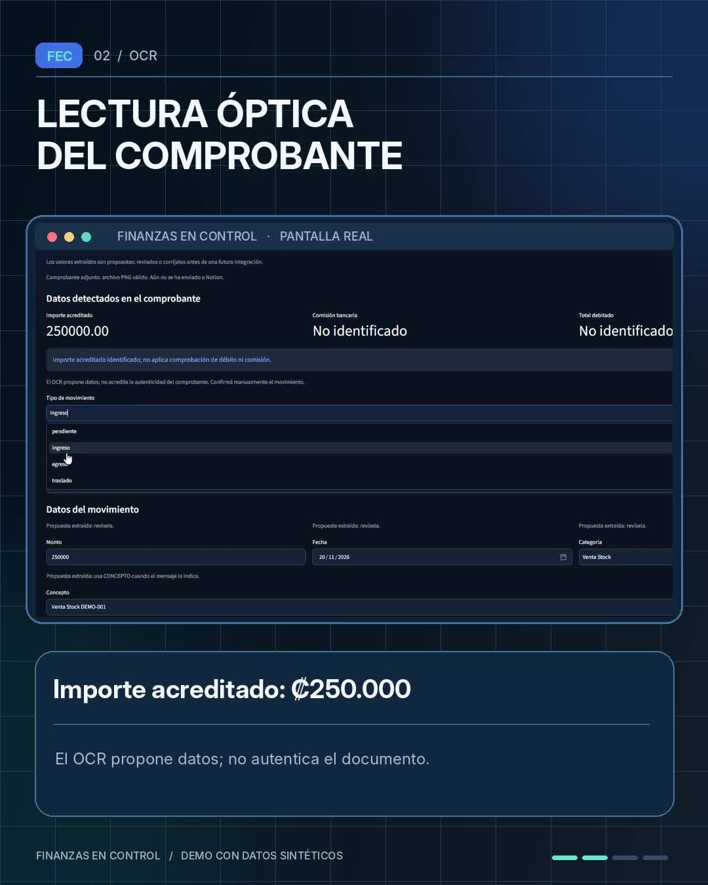
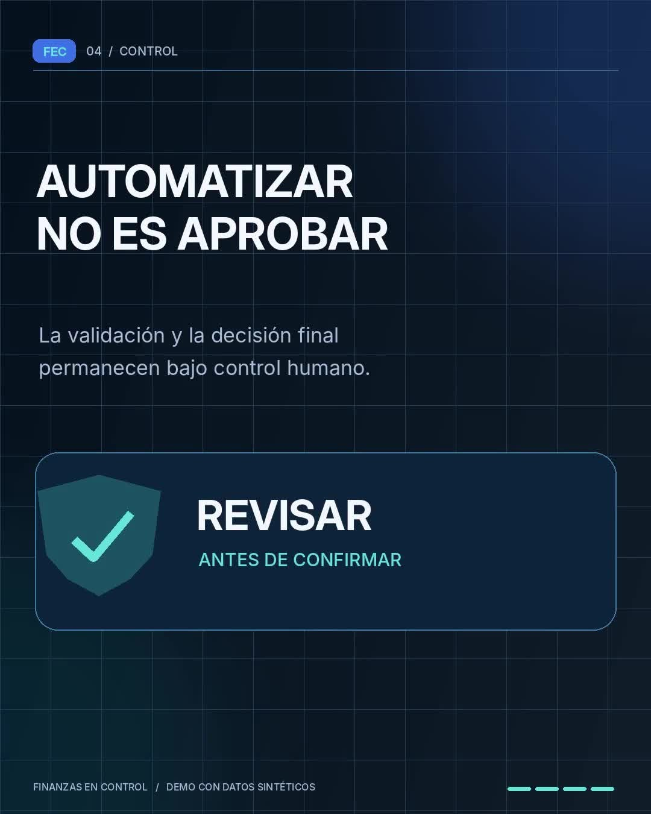

# Finanzas en Control — Technical Showcase



> **Public-safe portfolio companion, not a deployable copy of the private application.**

**Finanzas en Control** explores a practical financial-operations problem: turning unstructured messages and receipt images into reviewable, structured proposals without allowing automation to silently create financial records.

This repository is an intentionally small, independent showcase. It demonstrates selected engineering ideas with synthetic data and a dependency-free Python example. It does **not** contain the private application, production configuration, real receipts, persistent financial data, external-service connections, or authorization logic.

## Resumen en español

Este repositorio presenta, de forma segura y con datos ficticios, los principios técnicos de Finanzas en Control: interpretación de información financiera, OCR local, validación, prevención de duplicados y revisión humana. No es una copia funcional ni incluye código, datos, credenciales o infraestructura de la aplicación privada.

## Business problem

Financial teams often receive payment context through chat messages and image receipts. Manual re-entry is slow, while fully automatic registration can amplify OCR mistakes, incomplete context, and duplicate submissions. The useful outcome is a clear proposal for a person to review—not an unchecked financial action.

## Solution approach

The private application combines message interpretation, optional local receipt OCR, structured operation preparation, editable review, and defensive controls before any future financial integration. This showcase documents that architecture at a high level and supplies a standalone example of conservative amount extraction from synthetic OCR text.

| Scope | Private application | This public-safe showcase |
| --- | --- | --- |
| Financial workflow | Functional, private workflow | Architecture description only |
| OCR | Local Tesseract-based processing | Deterministic post-OCR amount parsing example |
| External services | Private and intentionally omitted | No external calls or configuration |
| Data | Never included here | Synthetic text only |
| Tests | Private suite (597 passing tests, project evidence) | Small executable showcase tests |

The “597 passing tests” figure and Docker validation of real Tesseract belong to the **private project evidence**, not to the test results in this repository.

## Key capabilities represented

- Message-to-proposal workflow design for income, expense, and transfer context.
- Optional OCR as an assistive input, not a source of unquestioned truth.
- Conservative monetary parsing after OCR, including common currency-symbol misreads and complete-token checks.
- Human review and editable fields before any consequential step.
- Duplicate-risk awareness at the workflow level, without exposing internal matching rules.
- Container-friendly and CI-oriented engineering practices described at a safe level.

## Technology context

Python · Streamlit · Tesseract OCR · Pillow · pytest · Docker · GitHub Actions · Render

Only Python standard-library code and `unittest` are required for the runnable showcase example. The technology list describes the broader private project context; no production dependencies or configuration have been copied here.

## High-level architecture



See [architecture documentation](docs/architecture.md) for boundaries and [security design](docs/security-design.md) for the defensive model.

## Processing flow

1. A user supplies message context and may attach a receipt.
2. The application interprets explicitly stated information and keeps uncertain fields pending.
3. OCR, when used, proposes fields from the image locally.
4. Validation and duplicate-risk checks surface uncertainty.
5. A human reviews and may correct the proposal.
6. Only an approved, separately governed next step could proceed. This showcase performs no such action.

## Security and human validation

OCR can confuse `₡`, `¢`, `C`, or punctuation in amounts such as `₡250,000.00`. The included parser is deliberately conservative: it returns a result only when it has one unambiguous, currency-marked amount. Otherwise, the amount remains unresolved for review. It never contacts an external service or stores a receipt.

Duplicate prevention matters because a familiar receipt or message can be submitted again. The private workflow uses defensive checks as a review aid; this repository describes the principle only and does not reveal matching criteria, identifiers, allowlists, authorization controls, or operational thresholds.

## Testing and quality

Run the self-contained tests from the repository root:

```powershell
python -m unittest discover -s tests -v
python -m compileall src
```

The test fixtures are synthetic and cover Costa Rican colón amounts, symbol substitutions, consistent decimal/grouping conventions, ambiguous amounts, and malformed or unmarked input. Details are in [engineering challenges](docs/engineering-challenges.md).

## Technical challenges and responses

| Challenge | Safe engineering response |
| --- | --- |
| OCR symbol/punctuation errors | Normalize only known presentation variants; keep ambiguity pending. |
| Incomplete messages | Model missing information explicitly instead of guessing. |
| Duplicate submissions | Treat possible repeats as review signals, not automatic decisions. |
| Financial impact | Require an accountable human review before any consequential operation. |
| Portable OCR environment | Validate OCR dependencies in a container in the private project; do not publish deployment details here. |

## Demo visuals (synthetic data only)

The following selected frames come from a recorded demonstration using fictional financial input. They were reviewed visually and re-exported without embedded camera/location metadata. They are **illustrative evidence of the private application**, not screenshots of the standalone parser in this repository.

| Message and receipt input | OCR results | Human review principle |
| :---: | :---: | :---: |
|  |  |  |

A full LinkedIn video demonstration is planned. **Publication URL pending**; no live-service access or data is provided through this repository.

See [media disclosure guidance](assets/README.md) before adding other screenshots or links.

## Learnings and next steps

Reliable financial automation is less about extracting a number and more about preserving uncertainty, traceability, and human accountability. Only add additional reviewed visual assets and the eventual LinkedIn publication URL; do not add private code, screenshots containing real financial information, environment files, or infrastructure settings.

## Repository map

```text
docs/       Public-safe architecture, security, and challenge notes
examples/   Synthetic OCR input only
src/        Standalone conservative parsing example
tests/      Executable synthetic-data tests
assets/     Reviewed synthetic demo images and media-disclosure guidance
```

## License and use

Portfolio material intended for demonstration. It should not be used as a production financial-processing system without independent security, compliance, and domain review.
