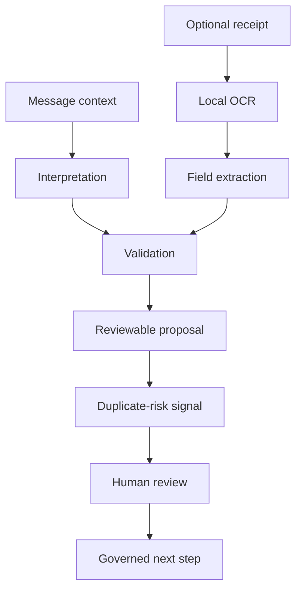

# Architecture overview

## Purpose and boundary

Finanzas en Control prepares a reviewable financial-operation proposal from message context and, optionally, receipt OCR. The architectural goal is to make uncertainty visible before any operation that could affect financial records.

This document represents the private application at a deliberately high level. It does not disclose source code, data models, endpoint details, service identifiers, deployment topology, authentication design, authorization rules, or external-integration configuration.

## Components

| Component | Responsibility | Showcase representation |
| --- | --- | --- |
| Message interpretation | Extract explicitly provided business context. | Documented only. |
| OCR adapter | Read receipt text locally when available. | Parsing is represented with synthetic OCR text. |
| Field extraction | Convert recognized text into cautious candidate fields. | `src/safe_ocr_example.py` parses one amount. |
| Validation | Flag missing, inconsistent, or ambiguous information. | The example refuses ambiguous candidates. |
| Duplicate-risk control | Ask for review when a repeat may be present. | Principle documented; rules omitted. |
| Human review | Correct and approve a proposal. | Architectural requirement documented. |

## Data handling

Receipt images and financial records are out of scope for this repository. The supplied example processes an in-memory Python string, uses no database, makes no network requests, and persists nothing.
